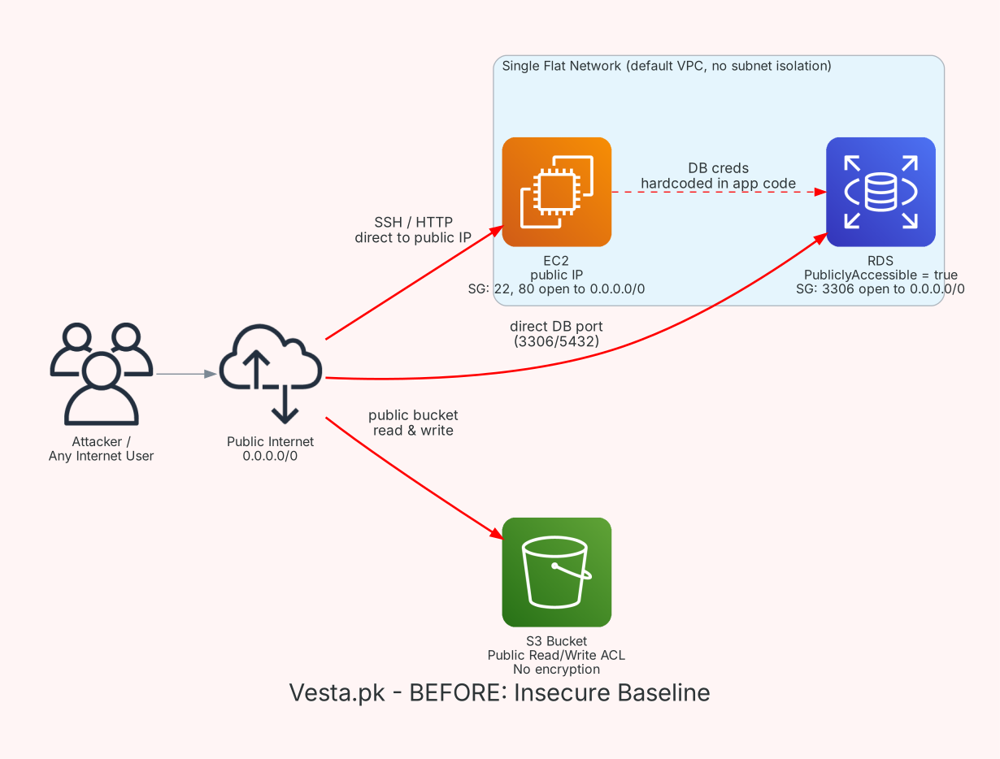
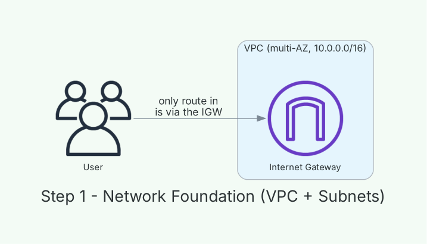
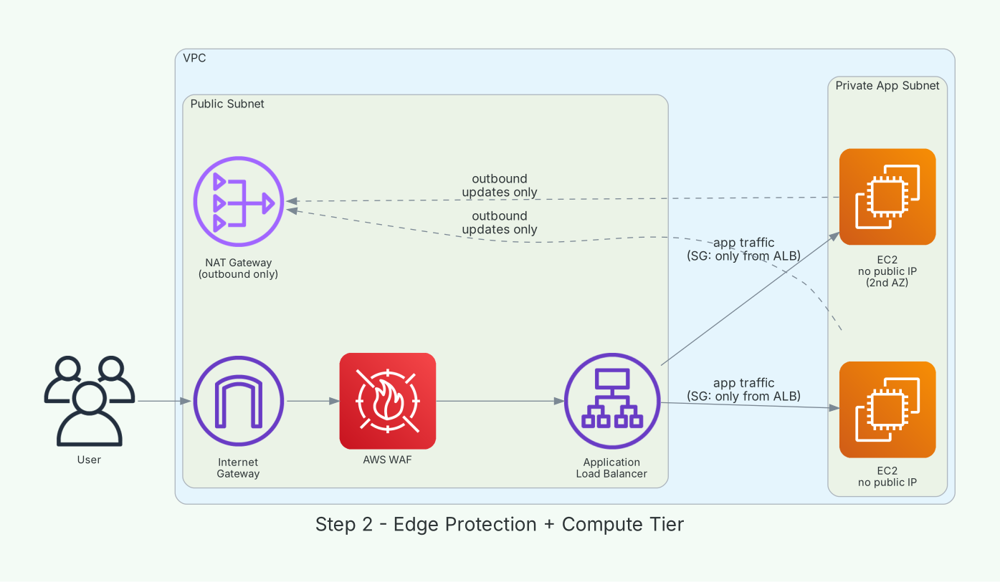
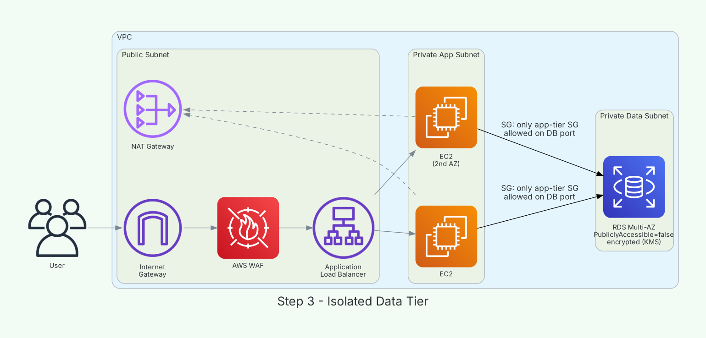
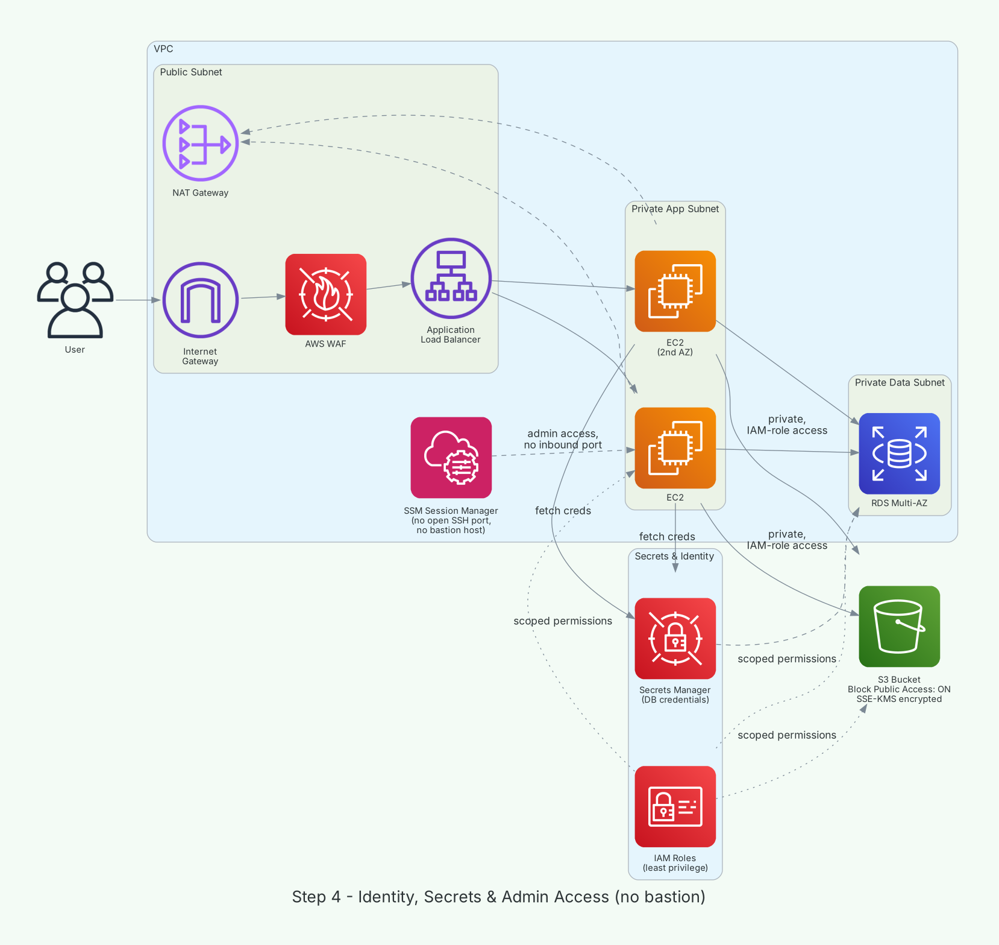
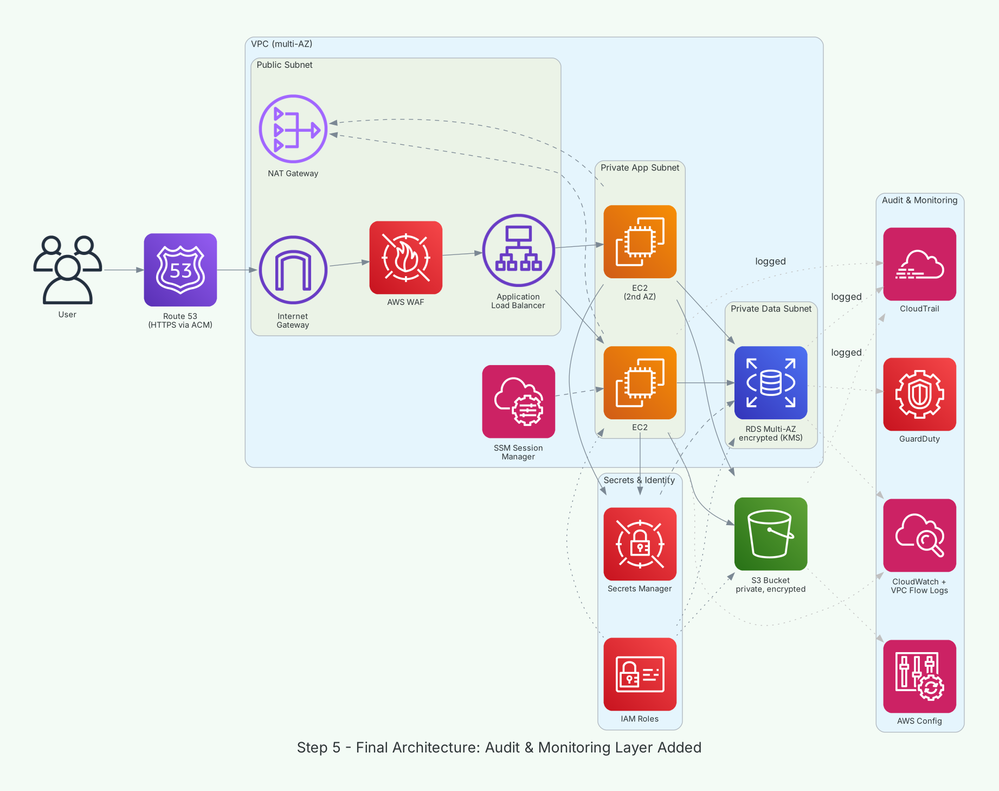

# Vesta.pk — Redesigning a Publicly-Exposed AWS E-Commerce Architecture

This is a hypothetical scenario I asked myself regarding a business venture, where as a cloud architect what would be my approach to a e-commerce infrastructure which is currently exposed. 
The original setup of the project put EC2, RDS, and S3 directly on the public internet.
This case study and solution walks through turning that into a defense-in-depth architecture,
one layer at a time, and explains the reasoning behind why I made every change.

> **Status:** This is just a case study (diagrammed and documented;
> not currently deployed). Built as a learning project to go deep on AWS
> network and identity security.

---

## Problem Statement

Vesta.pk's original infrastructure was functional but had no real security
boundary:

- **EC2** ran the application with a public IP, and its security group
  allowed SSH (22) and HTTP (80) from `0.0.0.0/0` — anyone on the internet
  could attempt to connect.
- **RDS** was set to `PubliclyAccessible = true`, with a security group
  allowing inbound traffic on the database port from `0.0.0.0/0`. The
  database — the most sensitive part of the system — was as exposed as the
  website itself.
- **S3** held a public read/write bucket with no encryption, meaning assets
  could be read *or tampered with* by anyone who found the bucket name.
- Database credentials were hardcoded into the application rather than
  managed separately.
- There was no network segmentation at all — everything sat in a single
  flat default VPC, so there was no boundary to contain a compromise even
  if one layer was breached.

In short: a single leaked IP, guessed credential, or unpatched package on
the EC2 instance could lead directly to full read/write access to the
database and the asset store, with no segmentation to slow an attacker
down.

### Design goals for the redesign

1. **No direct internet path to compute or data.** Only a load balancer
   should be internet-facing.
2. **Least privilege everywhere.** No component should have more access
   than the one task it performs requires.
3. **No standing SSH exposure.** Remote access should not depend on an open
   port anywhere.
4. **Encrypt and isolate data at rest and in transit.**
5. **Assume something will eventually go wrong — make sure it's logged.**

---

## Building the Secure Architecture, Step by Step

### Step 1 — Lay the network foundation (VPC + subnets)

Before touching compute or data, I fixed the actual root cause of the
original exposure: a single flat network with no boundary between "things
the internet should reach" and "things it shouldn't." I created a custom
VPC (`10.0.0.0/16`) spanning two Availability Zones for resilience, with
three subnet tiers per AZ:

- a **public subnet** — will hold only internet-facing resources,
- a **private app subnet** — for the application tier,
- a **private data subnet** — for the database.

Only the public subnet gets a route to an Internet Gateway. The other two
have no inbound path from the internet at all, by design, before a single
EC2 instance exists.

### Step 2 — Add edge protection and the compute tier

With the network shell in place, I added the pieces that actually face the
internet, and nothing else.

- **AWS WAF** sits in front of the load balancer and filters out common
  web exploits (SQL injection, XSS, known bad bots) before a request ever
  reaches application code.
- The **Application Load Balancer** is the single entry point into the
  private subnets. It terminates HTTPS and is the only thing allowed to
  initiate traffic to the EC2 instances.
- **EC2 instances** live in the private app subnet with **no public IP**.
  Their security group accepts traffic only from the ALB's security group
  — not from any IP range, so the rule stays correct even if IP ranges
  change later.
- A **NAT Gateway** in the public subnet gives those private instances
  outbound-only internet access (for OS/package updates) without ever
  being reachable from the outside.

### Step 3 — Isolate the data tier

Next, the database moved into its own private data subnet — one tier
further from the internet than the app servers.

- `PubliclyAccessible = false`, so there is no scenario — correct security
  group rule or not — where RDS is reachable from outside the VPC.
- The security group allows inbound traffic **only from the app tier's
  security group** on the database port, not from a CIDR block. Reference
  by security group rather than IP range means the rule stays correct even
  if the app subnet's address range ever changes.
- **Multi-AZ** is enabled so a failure in one Availability Zone doesn't
  take the database down.
- **Encryption at rest (KMS)** is enabled, since this tier holds customer
  and order data.

### Step 4 — Replace the bastion: identity, secrets & admin access

This is where I deliberately changed the design I started from. The
reference architecture I used as a starting point relied on a **bastion
host** for SSH access into the private EC2 instances — workable, but it
still means a port is open somewhere, SSH keys have to be managed and
rotated, and access is only as safe as that one host.

I replaced it with **AWS Systems Manager Session Manager**:

- Administrators get a shell on the EC2 instances through IAM-authenticated
  API calls — **no inbound port open anywhere** in the app subnet's
  security group.
- Every session is logged automatically, with no separate SSH audit trail
  to maintain.

Alongside that, I closed the other gaps the reference design left open:

- **IAM roles** attached to EC2, scoped to only what the app needs (e.g.,
  read one specific S3 bucket) — no long-lived access keys baked into the
  application.
- **Secrets Manager** holds the database password. It's fetched at runtime
  instead of living in a config file, and can rotate automatically.
- **S3**, which the original scenario mentioned but the reference diagram
  never actually addressed: Block Public Access is on account-wide, the
  bucket policy trusts only the application's IAM role, and objects are
  encrypted with SSE-KMS.

### Step 5 — Add the audit & monitoring layer

The last layer doesn't change how traffic flows — it makes sure nothing
happens without a record.

- **CloudTrail** logs every API call made against the account (who changed
  a security group, who read a secret, when).
- **CloudWatch + VPC Flow Logs** give visibility into application metrics
  and network traffic patterns.
- **GuardDuty** continuously analyzes that activity for signs of
  compromise — e.g., an EC2 instance suddenly communicating with a known
  malicious IP.
- **AWS Config** tracks configuration drift, so if a security group rule
  is ever loosened outside of change control, it's flagged automatically
  instead of discovered during an incident.

---

## Security Control Mapping

| Risk in the original design | Control applied | AWS service(s) |
|---|---|---|
| Database reachable from the internet | Removed public route, isolated in a private subnet, `PubliclyAccessible=false` | VPC, RDS |
| App server reachable from the internet | No public IP; traffic only via load balancer | EC2, ALB, Security Groups |
| Malicious / exploit HTTP requests | Filtered at the edge before reaching the app | AWS WAF |
| SSH exposure via bastion host | Removed inbound SSH entirely | AWS Systems Manager Session Manager |
| Hardcoded DB credentials | Externalized, fetched at runtime, rotatable | Secrets Manager |
| Over-privileged / long-lived access keys | Least-privilege IAM roles | IAM |
| Public, unencrypted S3 bucket | Block Public Access + scoped bucket policy + encryption | S3, KMS |
| No visibility into account activity | Centralized audit logging | CloudTrail |
| No automated threat detection | Continuous monitoring | GuardDuty |
| Configuration drift unnoticed | Compliance/config tracking | AWS Config |

---

## Tools Used

- AWS services covered: VPC, Subnets, Internet Gateway, NAT Gateway, ALB,
  WAF, EC2, RDS, S3, IAM, Secrets Manager, Systems Manager, CloudTrail,
  CloudWatch, GuardDuty, Config, KMS, Route 53, ACM.

---

## Credits

The starting architecture concept (WAF → ALB → EC2 → RDS with a bastion
host) was inspired by a publicly available YouTube tutorial. The gap
analysis, the S3 security story, the bastion → SSM Session Manager
replacement, secrets management, and the audit/monitoring layer were
researched and designed independently as extensions to that starting
point.
